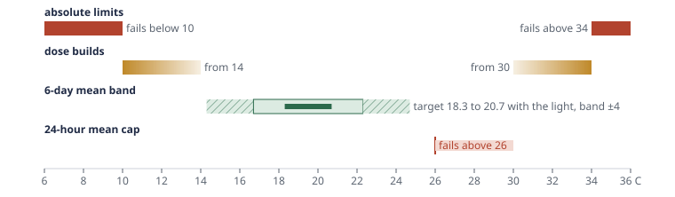
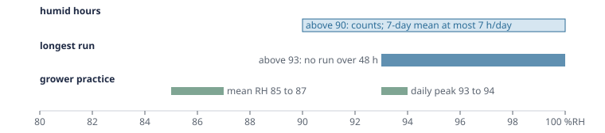

# Crop-safety rules for judging greenhouse climate controllers

Greenhouse control studies count or penalise climate violations, but in the work we reviewed none states how much a crop can take. Phytotron judges each simulated season of a tomato crop against six rules, each taken from a published source, and fails the season for a climate class if any of that class's rules breaks.

## Why not a simple band

A band such as "15 to 34 C, at most 85% RH" fails almost every season of every controller, because brief excursions are normal and mostly harmless. Tomato responds to the 24-hour and multi-day mean temperature, with short swings tolerated if the mean holds (de Koning 1988; Körner and Challa 2003). Heat damage to fruit set follows sustained high daily means (Adams et al. 2001). Grey mould risk follows the number of humid hours, and dry breaks do not reset it (Eden et al. 1996). The rules below measure harm in those terms.

## The six rules

{{rules_table}}

*Air temperature, to scale. The rules nest from the outside in: absolute limits, then where the dose starts to build, then the 6-day band, with the 24-hour cap above it. The dark bar is the range of 6-day targets on the four held-out springs; the hatched ends show how far the band moves with the light.*

*Relative humidity, to scale. Humid hours measure accumulated grey-mould risk; the longest run catches one long wet spell. "Grower practice" is the Het Nieuwe Telen Tomaat 2010 spring trial, where grey mould stayed controllable.*

On four spring seasons of Amsterdam weather (2022 to 2025, the weather files named by hash in the run record), the light-following 6-day target runs from 18.3 to 20.7 C, so the allowed band reaches from about 14.3 to 24.7 C. The rules nest: absolute limits outside the dose onsets, the dose onsets outside the 6-day band, and the 24-hour cap above it. CO2 and lamp use are reported, not gated: their effects are economic and already priced in net value. Phytotron also reports the night-time humidity deficit (g/m3), the measure Dutch growers steer on.

## From seasons to a verdict

{{gate_summary}}

Every verdict reports the failing count and the bound next to pass or fail. Only controllers that pass are ranked on economics.

## What these rules do not claim

- Two rules come from other crops: humid hours from a cucumber leaf-wetness rule, the longest run from chrysanthemum. No published tomato rule of either form was found.
- The simulator has no leaf wetness, so high RH stands in for it.
- Körner and Challa use their temperature dose to trigger a control action. Using it as pass/fail, summed over a rolling window, is Phytotron's design choice.
- The numbers were fixed from the sources before any controller was scored under them. Any change is versioned and published with its reason. Protocol 1 (10 October 2026) failed a season at any single step beyond the absolute limits; protocol 2 (same day, after the first run was scored) requires 30 minutes or more in a row, the dose rule's full-dose time. Results are reported under both until the next run.

## Sources

{{sources_list}}
