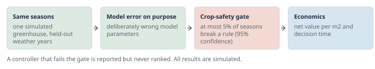

# Which greenhouse climate controller is better, and is it safe for the crop?

Phytotron by Growmatics is an open, simulated benchmark for greenhouse climate control. It runs every controller through the same simulated seasons, checks the climate it produced against crop-safety rules from the horticultural literature, and only then compares the money it made.

## Why a benchmark

Papers on greenhouse control, from rule-based setpoints to model predictive control and reinforcement learning, each use their own greenhouse model, weather, prices and constraints. Their numbers cannot be compared. In our reading of the literature, none says how much climate violation a crop can take: violations are counted or penalised, never judged against a crop-safety standard. Phytotron fixes the scenario, the scoring and the safety standard, so results from different groups can be put side by side.

## How a controller is judged

1. **Same seasons for everyone.** A simulated Venlo tomato greenhouse, built on the GreenLight model through GreenLight-Gym2, with Amsterdam weather. 60-day spring seasons on held-out weather years the controller was never tuned on.
2. **Model error on purpose.** A controller that uses a model gets one with deliberately wrong parameters, at several levels. Planning with the simulator's own model would be the "inverse crime" and is reported only as a labelled reference.
3. **Crop safety first.** Each season is checked against six rules on temperature and humidity, each taken from a published source. A controller passes if, with 95% confidence, at most 5% of its seasons break a rule. [See the rules and their sources.](/phytotron/crop-rules)
4. **Then economics.** Controllers that pass are compared on net economic value (fruit growth revenue minus heating, CO2 and electricity costs, in EUR per m2) and on decision time. The rule-based incumbent is always shown as the reference.

*Four stages, in this order. First every controller runs the same simulated seasons, on weather years it was never tuned on, so the comparison is fair. Second, a controller that plans with a model gets a deliberately wrong one, so it cannot win by knowing the simulator's answer key. Third, every season is checked against the crop-safety rules, and a controller whose seasons break them too often is stopped here. Only then, fourth, are the controllers that passed compared on what they earned per square metre and how long each decision took.*

All Phytotron results are simulated. Phytotron is a benchmark and simulation tool, not a controller product and not a model of any named greenhouse.

## Progress

- **11 October 2026.** Code public as version 0.1.0: the benchmark, the two reference controllers, the crop-safety gate, the `phytotron` command and the first simulated results, at [github.com/growmatics/phytotron](https://github.com/growmatics/phytotron).
- **10 October 2026.** Crop-safety rules fixed from the sources, with a versioned protocol. First simulated run of the two reference controllers scored under them. The public repository opened with the project description. This site went live.

## Roadmap

| When | What | Status |
|---|---|---|
| Q4 2026 | Code public as version 0.1: the benchmark, a rule-based incumbent and an economic MPC as reference controllers, the crop-safety gate, and the first simulated results. | done, 11 October 2026 |
| Q4 2026 | Invitations to research groups to submit controllers. | planned |
| Q1 2027 | Calibration against Autonomous Greenhouse Challenge data. The first outside controllers scored. | planned |
| Q2 2027 | Software paper submitted to the Journal of Open Source Software. Talk or poster at GreenSys 2027 in Wageningen (June). | planned |
| H2 2027 | Web interface and a public leaderboard. | planned |

## Take part

**Bring your controller.** Rule-based, MPC or RL: anything that maps the greenhouse state to heating, CO2, screens, ventilation and lamps can be scored. If your group works on greenhouse control and wants to be among the first scored, open an issue or start a discussion on the repository.

**Follow the work.** Watch [github.com/growmatics/phytotron](https://github.com/growmatics/phytotron) for the 0.1 release in Q4 2026. The license is AGPL-3.0-or-later, the same as the simulator it builds on.

## Questions

**Is Phytotron a digital twin of a real greenhouse?**
No. It is a simulated benchmark. Calibration against measured data from the Autonomous Greenhouse Challenge is planned for Q1 2027, and even then results stay labelled simulated.

**Which simulator does it use?**
The GreenLight greenhouse and tomato model (Katzin et al.; Vanthoor et al.) through GreenLight-Gym2 by van Laatum et al.

**Why not rank on profit alone?**
A controller can earn more by letting the crop sit too cold, too hot or too humid. The gate stops that from looking like a win.

**Is there a benchmark for greenhouse climate control?**
Phytotron is one: an open, simulated benchmark that fixes the scenario (a Venlo tomato greenhouse on held-out Amsterdam weather), the scoring (net economic value and decision time) and a crop-safety standard with published sources, so controllers from different groups can be compared. It is not calibrated against a real greenhouse; that step is planned for Q1 2027.

**How do I compare MPC and reinforcement learning for a greenhouse?**
Run both through the same simulated seasons. Give the model-based one a deliberately wrong model, since a real greenhouse never matches its model. Check every season against crop-safety rules first, and only then compare net value and decision time. Phytotron does exactly this: an MPC plugs in as a controller class, a trained RL policy runs through a wrapper, and both are scored the same way against a rule-based reference.

**What is the GreenLight model?**
GreenLight is a greenhouse climate and tomato crop model from Wageningen University & Research (Katzin et al., 2020), built on the Vanthoor greenhouse and crop model (Vanthoor et al., 2011). It simulates the indoor climate, the energy use and the crop's growth from the outdoor weather and the controls. Phytotron uses it through GreenLight-Gym2 (van Laatum et al.), at a pinned version named in every result.

**Who is behind it?**
[Growmatics B.V.](https://growmatics.ai) in the Netherlands develops and sponsors Phytotron and keeps it free.
